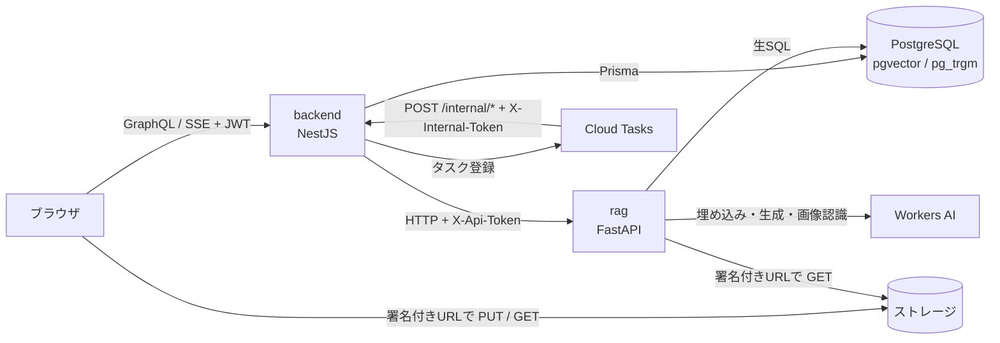
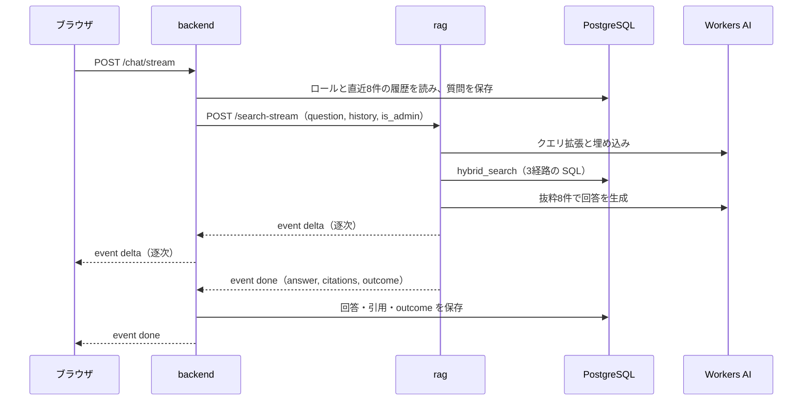

<h1 align="center">Manualy — 実装詳細</h1>

本資料は、Manualy が**どう作られているか**を、データ構造・パラメータ・SQL・コードの単位で説明する。何のために作り、何が良くなったか（動機と測定結果）は [作品説明資料](https://github.com/mocaluna0117/manualy/blob/main/docs/portfolio/PORTFOLIO.md) にあるので繰り返さない。数値と名前はすべてリポジトリのコードとマイグレーションから引き、根拠のファイルを各節にリンクした。

---

## 1. 全体の構成

### 1.1 サービスの分担

| サービス | 技術 | 責務 |
|---|---|---|
| frontend | React + Apollo Client | 画面。ファイル本体は署名付きURLでストレージと直接やりとりする |
| backend | NestJS + GraphQL（回答のみ SSE）+ Prisma | 認証・権限・会話の保存・管理操作の実行・ジョブの発行 |
| rag | Python + FastAPI + psycopg | 取り込み・検索・回答生成・分類。DB は生SQLで読み書きする |
| DB | PostgreSQL 16 + pgvector + pg_trgm | マニュアル・チャンク・会話と、ベクトル・部分一致の索引 |

**rag は利用者を知らない。** 誰が聞いたか、管理者かどうかは backend が決め、rag には `is_admin` の真偽値だけを渡す。



### 1.2 境界ごとの守り

| 経路 | 仕組み |
|---|---|
| ブラウザ → backend | JWT を発行元の JWKS の公開鍵で検証する。署名方式の許可リストは RS/ES/PS 系だけで、HS* と none は無い（[auth/config.ts][auth-config]）。ロールは JWT ではなく DB の `User.role` から読む（[roles-guard.ts][roles-guard]） |
| backend → rag | `X-Api-Token` を `hmac.compare_digest` で比較。`RAG_API_TOKEN` が未設定なら全部 503 で拒否する fail-closed（[security.py][security]） |
| Cloud Tasks → backend | `X-Internal-Token` を両方 SHA-256 にしてから `timingSafeEqual` で比較。未設定なら 401（[job/controller.ts][job-controller]） |
| rag → ストレージ | 15分有効の署名付きURLだけを受け取り、スキーム・許可ホスト・名前解決先IP（リンクローカル等を拒否）を検証。既定で100MB・60秒の上限（`fetch_file`） |

### 1.3 質問1回の流れ



取り込みは逆向きで、ブラウザが署名付きURLへファイルを PUT し、`registerManual` で登録すると backend が Cloud Tasks に積んですぐ応答する。Cloud Tasks が backend の `/internal/ingest` を呼び、backend は GET 用の署名付きURLを rag の `/ingest` に渡す。**ファイル本体は backend を通らず、rag にもバケットの認証情報は渡さない**（[storage/service.ts][storage]、[manual/service.ts][manual-service] の `runIngest`）。

---

## 2. 取り込み：ファイルを「区切り」の列にする

`/ingest`（[main.py][main] の `ingest`）は、形式に関わらず本文を**区切りのリスト**にする。この区切りが、引用に出す「ページ番号」の単位になる。

### 2.1 形式ごとの抽出

| 形式 | 区切り | 抽出の要点（[extract.py][extract]） |
|---|---|---|
| PDF | ページ | pypdf の `extract_text()` |
| Excel | シート | openpyxl を `data_only=True` で開き、数式ではなく計算結果を読む。1セル2,000字で打ち切る |
| PowerPoint | スライド | テキスト枠・表に加え、発表者ノートを「(ノート) 」付きで拾う |
| Word | 全体で1つ | 段落を上から、続けて表を行ごとに |
| Outlook (.msg) | 全体で1つ | 件名・差出人・宛先・日付・添付ファイル名を本文の前に付ける |

PDF 以外はシート名や「スライド3」を見出しとして `見出し\n本文` を1つの区切りにする。

### 2.2 スキャンページの書き起こし

文字の取れない PDF のページは、OCR エンジンではなく**マルチモーダルLLMの画像認識**で書き起こす（[vision.py][vision]、[main.py][main] の `ingest`）。

| 項目 | 値 |
|---|---|
| 対象 | 抽出テキストが `MIN_TEXT_CHARS_PER_PAGE = 20` 字未満のページ |
| 上限 | 1文書 `MAX_TRANSCRIBE_PAGES = 60` ページ。超えた分は空のまま |
| 画像化 | pypdfium2 で `scale=2.0`（約144dpi）、JPEG 品質85 |
| 並列 | 4本（0.5 vCPU / 1GB のコンテナで詰まらない範囲） |
| 失敗 | そのページだけ空のまま残し、取り込み全体は止めない |

白紙のページを渡すと、モデルは例外ではなく「申し訳ありませんが…含まれていません」という**断り文を返す**。そのままでは断り文がマニュアル本文として検索に載るので、`_looks_like_refusal` が「300字以下で、『申し訳』などで始まるか、『画像』と『含まれていません』などの目印を含む」文を断り文とみなし、そのページを諦める。

### 2.3 Unicode の正規化

```python
_RADICALS = re.compile(r"[⺀-⻳⼀-⿕]")

def normalize_text(text: str) -> str:
    text = _RADICALS.sub(lambda m: unicodedata.normalize("NFKC", m.group()), text)
    return unicodedata.normalize("NFC", text)
```

- **NFD**: macOS 由来の文字列では「が」が「か＋濁点」の2文字になり、NFC で入力した検索語の `ILIKE` に当たらない。全体を **NFC** に揃える
- **康熙部首**: macOS のフォントを埋め込んだ PDF では「方」が部首の「⽅」(U+2F45) として抽出されることがあり、NFC では畳まれない。**部首のブロックにだけ NFKC** を掛ける

rag は本文・埋め込みに使うタイトル・検索クエリに掛ける。backend は登録時にタイトルとファイル名を、改名時にタイトルを NFC にし、既存データは [normalize-titles.ts][normalize-titles] が PostgreSQL の `normalize(title, NFC)` で直す。

---

## 3. チャンク分割：pgvector に入れる単位

### 3.1 分割関数

```python
def split_text(text: str, chunk_size: int = 800, overlap: int = 200) -> list[str]:
    ...
    start = 0
    while start < len(text):
        end = start + chunk_size
        chunks.append(text[start:end])
        if end >= len(text):
            break
        start = end - overlap
    return chunks
```

[chunking.py][chunking] は**文字数の固定長窓**で、文や段落の境界は見ない。単位はトークンではなく Python の文字数である。

| パラメータ | 値 | 例 |
|---|---|---|
| `chunk_size` | 800 | 800字以下の区切りは1本 |
| `overlap` | 200 | 801字なら2本（0–800字目、600–801字目） |
| 刻み幅 | 600 | 2,000字なら3本（0–800、600–1,400、1,200–2,000） |

境界で切れた文は重なりによって隣のチャンクにも丸ごと残る。この性質と、空文字なら空リスト、`overlap >= chunk_size` は例外（無限ループ防止）を [test_parsers.py][test-parsers] で固定している。

### 3.2 区切りをまたがない

```python
for page_no, text in enumerate(pages, start=1):
    for piece in split_text(text):
        chunks.append((piece, page_no))
```

`split_text` は**区切り1つごとに**呼ぶので、チャンクが2ページにまたがることはなく、どのチャンクにも番号が1つだけ付く。引用で「p.3」と1ページを指せるのはこのためである。

- 文字の無いページはチャンクを作らないが番号は進むので、**PDF の `page_number` は物理ページ番号と一致**する
- `chunk_index` は文書内の通し番号（0始まり）で、`(manual_id, chunk_index)` に一意制約がある

> [!NOTE]
> PDF 以外の `page_number` は「中身のあった区切りの通し番号」で、実際のスライド番号やシート名は本文先頭の見出し行が持つ。見出しは区切りの先頭に1回だけ付くので、長いシートの2本目以降のチャンクには入らない。

### 3.3 埋め込む文字列と保存する文字列を分ける

```python
embeddings = embedder.embed_texts(
    [f"{title}\n{content}" if title else content for content, _page in chunks]
)
```

| | 中身 | 理由 |
|---|---|---|
| 埋め込みの入力 | `タイトル\n本文` | 記入見本や表紙のように本文に手がかりの無いチャンクにも、「どの文書の断片か」を意味検索で効かせる |
| `content` 列 | 本文だけ | タイトルを入れると引用のスニペットに重複して出るうえ、全チャンクがタイトルの語の `ILIKE` に当たってキーワード検索が溢れる |

ベクトルがタイトルに依存するので、**改名するとベクトルも作り直す**。backend の `rename()` が rag の `/reembed-title` を呼び、ファイルは読み直さず埋め込みだけを更新する。

### 3.4 保存

既存チャンクの `DELETE` と新しいチャンクの `INSERT` を同じ接続の `with` ブロックで行い、1つのトランザクションで差し替える。同名ファイルでの差し替えでは、backend が先に旧チャンクを消して状態を `PENDING` に戻すので、再取り込みが失敗しても旧版の内容で答えることはない。

---

## 4. 埋め込み

### 4.1 差し替え口

[embedding.py][embedding] は `embed_texts(texts) -> list[list[float]]` だけの `Embedder` を定め、`EMBEDDING_PROVIDER` で実装を選ぶ。どれも `DIMENSIONS = 1024` で、列の `vector(1024)` と一致させる。

| 値 | 中身 | 用途 |
|---|---|---|
| `workers_ai` | `@cf/baai/bge-m3`（`CF_EMBEDDING_MODEL`）を OpenAI 互換 API で呼ぶ | 現在の本番 |
| `bedrock` | `amazon.titan-embed-text-v2:0`。入力を8,000字で切り、8並列 | AWS 時代の本番 |
| `hashing`（既定） | 文字3-gram を `zlib.crc32` で1024個の箱へ符号付きで足し、L2正規化 | ローカル開発。資格情報なしで配管を通す |

質問も、チャンクと同じ `embedder` でベクトルにする。

### 4.2 WorkersAiEmbedder の検査

**静かに壊れたベクトルを返さない**のが方針で、次の場合は例外にして取り込みを `FAILED` にする（[test_workers_ai_embedding.py][test-embedding] で固定）。

- **32本ずつ**送り、応答の順序を前提にせず `index` で入力と対応付ける。本数の不足・欠番は例外
- 次元が1024でなければ例外
- ノルムが `1e-6` 未満（0ベクトル）なら例外。1から `1e-3` 以上ずれていれば自前で長さ1に直す（検索はコサイン距離で比べる）

### 4.3 再試行と列名

Workers AI の呼び出しは [llm.py][llm] の `_call_workers_ai` に集めてある。SDK の再試行は切り、0.5 / 1 / 2 秒待って最大4回、408・409・429・5xx と接続断だけをやり直す。ただし**エラーコード 4006（1日の無料枠切れ）の 429 は再試行せず**、日本語のメッセージで止める。待っても回復しないためである。

ベクトルの列名は SQL に埋め込むので、rag は起動時に `EMBEDDING_COLUMN` を許可リスト（`embedding_v2` だけ）と照合し、外れていれば起動しない。

---

## 5. スキーマと索引

### 5.1 ManualChunk

```prisma
model ManualChunk {
  ...
  chunkIndex  Int     @map("chunk_index")
  pageNumber  Int?    @map("page_number")
  content     String
  embeddingV2 Unsupported("vector(1024)")? @map("embedding_v2")

  @@unique([manualId, chunkIndex])
}
```

Prisma は pgvector の型を扱えないので `Unsupported` で宣言し、読み書きは rag の生SQLだけで行う（[schema.prisma][schema]）。マニュアルを消すとチャンクも `ON DELETE CASCADE` で消える。

### 5.2 生SQLで張った索引

```sql
CREATE INDEX IF NOT EXISTS "ManualChunk_embedding_v2_hnsw_idx"
  ON "ManualChunk" USING hnsw (embedding_v2 vector_cosine_ops);

CREATE INDEX IF NOT EXISTS "ManualChunk_content_trgm_idx"
  ON "ManualChunk" USING gin (content gin_trgm_ops);
```

| 索引 | 種類 | 使う問い合わせ |
|---|---|---|
| `ManualChunk_embedding_v2_hnsw_idx` | HNSW・`vector_cosine_ops` | 経路1の `<=>`（コサイン距離） |
| `ManualChunk_content_trgm_idx` | GIN・`gin_trgm_ops` | 経路2と画面のキーワード検索の `ILIKE '%語%'` |
| `Manual_title_trgm_idx`・`Manual_file_name_trgm_idx` | GIN・`gin_trgm_ops` | 経路3と画面のキーワード検索 |
| `Manual_ingest_status_idx` | B-tree | 取り込み完了の絞り込み |

演算子クラスは検索側の演算子（`<=>`）に合わせる。前後にワイルドカードの付く部分一致は B-tree では引けないので、3文字単位に分ける pg_trgm の GIN を使う。HNSW の `m`・`ef_construction`・`ef_search` は指定しておらず、pgvector の既定値で動いている（[add_search_indexes][mig-search]、[embedding_v2][mig-v2]）。

### 5.3 マイグレーションを手で書く理由

Prisma のスキーマはこれらの索引を知らないので、`prisma migrate dev` が生成する SQL には**生SQLで作った HNSW・pg_trgm 索引の `DROP` が必ず混ざる**。そのまま流すと検索が黙って壊れるため、`20260815065228_category_name_unique_only_alive` 以降の13本は必要な文だけを手で書いている。Prisma で書けない部分インデックス（ゴミ箱以外で名前を一意にする `WHERE deleted_at IS NULL`、実行中の再分類を1本にする `WHERE running`）も生SQLの側にだけある。

### 5.4 埋め込み列の世代交代

| マイグレーション | 内容 |
|---|---|
| `20260708141900_add_manual_chunk` | `CREATE EXTENSION vector`、`embedding vector(1024)` |
| `20260727234701_add_search_indexes` | 旧列の HNSW、pg_trgm の GIN ×3 |
| `20260908120000_embedding_v2_and_reclassify_job` | `embedding_v2 vector(1024)` と HNSW を追加。旧列は残す |
| `20260912000000_drop_legacy_embedding` | 旧 `embedding` 列と HNSW を `DROP` |

旧モデル（Titan V2）と新モデル（bge-m3）は同じ1024次元でも**ベクトル同士を比べられない**。上書きせずに列を分け、全件を埋め終えてから検索の列を切り替え、そのあと旧列を落とした。旧列は Supabase 無料枠（500MB）のうち約50MB（索引32MB＋列18MB）を占めていた（[drop_legacy_embedding][mig-drop]）。

---

## 6. 検索：3経路と RRF

[main.py][main] の `retrieve` が検索語を作り、`hybrid_search` が3本の SQL を流し、`fuse_by_rrf` が1本の順位にまとめる。

### 6.1 検索語を作る

1. **クエリ拡張**: `rewrite_query` が LLM（温度0）に、同義語や正式名称を含む10語以内のキーワード列を作らせる。直近6発言を文脈に入れるので「2です」のような返事も検索できる。失敗したら元の質問文で続ける
2. 添付画像があれば、画面名やエラーメッセージを抜き出した説明文を足す
3. `normalize_text()` を掛け、この文字列を1本埋め込む。同じ文字列を空白で割った**2文字以上の語を先頭10語まで**キーワードにする

検索は展開後の文字列で行うが、**LLM に渡す「質問」は元の質問文のまま**である。

### 6.2 経路1：ベクトル

```sql
WITH nearest AS MATERIALIZED (
    SELECT id, manual_id, content, page_number,
           embedding_v2 <=> %s::vector AS distance
    FROM "ManualChunk"
    WHERE embedding_v2 IS NOT NULL
    ORDER BY distance
    LIMIT 40
)
SELECT n.id, n.manual_id, m.title, n.content, n.page_number
FROM nearest n
JOIN "Manual" m ON m.id = n.manual_id
WHERE m.ingest_status = 'COMPLETED' AND m.deleted_at IS NULL
  AND NOT EXISTS (...)   -- 鍵付きフォルダ（6.5）
ORDER BY n.distance
LIMIT 20
```

- 最近傍は `ManualChunk` 単体で完結させる。JOIN を含めたまま `ORDER BY` を書くと「JOIN してからソート」の計画になり、HNSW が使われない
- `AS MATERIALIZED` で CTE のインライン展開を防ぎ、索引を確実に使わせる
- 絞り込みを外に出したぶんの目減りを見込み、**内側は40件、外側で20件**にする
- JOIN を挟むと内側の順序は保たれないので、外側でも `distance` で並べ直す。忘れると RRF に渡る順位が崩れる

### 6.3 経路2：キーワード

```sql
SELECT mc.id, ..., ((CASE WHEN mc.content ILIKE %s THEN 1 ELSE 0 END) + ...) AS hits
FROM "ManualChunk" mc JOIN "Manual" m ON m.id = mc.manual_id
WHERE ... AND (mc.content ILIKE %s OR ...) AND NOT EXISTS (...)
ORDER BY hits DESC LIMIT 20
```

一致したキーワードの**数**で並べる。`ILIKE` を `WHERE` にも書くのが要点で、`SELECT` 句で数えるだけだと全チャンクを評価することになり、pg_trgm の索引が使われない。

### 6.4 経路3：タイトル

```sql
SELECT * FROM (
    SELECT DISTINCT ON (m.id) mc.id, ..., (...) AS hits
    FROM "ManualChunk" mc JOIN "Manual" m ON m.id = mc.manual_id
    WHERE ... AND (m.title ILIKE %s OR ...)
    ORDER BY m.id, mc.chunk_index
) t
ORDER BY hits DESC LIMIT 20
```

本文に手がかりの無いマニュアルはタイトルでしか見つからない。`DISTINCT ON (m.id)` で**マニュアルごとに先頭チャンク1件だけ**を代表にするのが要点で、全チャンクを返すとタイトルの一致した1本が上位を占めてしまう。

### 6.5 共通の絞り込みと鍵付きフォルダ

```python
HIDE_ADMIN_ONLY = """
              AND NOT EXISTS (
                  SELECT 1 FROM "ManualCategory" c
                  WHERE c.id = m."categoryId" AND c.admin_only
              )"""
```

3経路のすべてに「取り込み完了」「ゴミ箱でない」「鍵付きフォルダでない」が入る。差し替え途中の版や捨てた資料を AI が引用しないためである。`NOT EXISTS` なので未分類の資料は残り、キーワード条件は `AND (a OR b ...)` と括弧で包んでから除外条件とつなぐ。**管理者の質問でも外す**のは、鍵付きが業務の回答に使わない資料の置き場で、8件しかない根拠の枠を奪うためである。

`hybrid_search` には権限の引数をあえて持たせていない。[test_search.py][test-search] の `TestHideAdminOnly` は、SQL を記録するだけの偽カーソルで3本の SQL に除外条件があることを確かめ、さらに関数の引数が `(cur, query_vec, terms)` だけであること、呼び出しがすべてその形であることを検査する。

画面の一覧・キーワード検索を担う backend では、`visibleTo()` が除外条件を**配列で返して `AND: [...]` に入れる**（[manual/service.ts][manual-service]）。以前は `{ OR: [...] }` というオブジェクトを `where` に展開していたため、キーワード検索で同じ階層に `OR` を書くと後のキーが前を上書きし、除外が黙って消えていた。[admin-only.spec.ts][admin-only-spec] が、一般利用者に一覧・キーワード検索・ダウンロードのどこからも鍵付きの中身が出ないことを固定している。

### 6.6 RRF で1本の順位にまとめる

$$
\mathrm{score}(c) = \sum_{r=1}^{3} \frac{1}{60 + \mathrm{rank}_r(c)}
$$

```python
for rows in routes:
    for rank, row in enumerate(rows, start=1):
        scores[row[0]] = scores.get(row[0], 0.0) + 1.0 / (RRF_K + rank)
        meta.setdefault(row[0], row[1:5])
ranked = sorted(scores, key=lambda cid: scores[cid], reverse=True)[:TOP_K]
```

キーは**チャンクの id** なので、複数の経路に出たチャンクほど点が積み上がる。「ベクトル2位・キーワード1位」なら 1/62 + 1/61 ≈ 0.0325 で、「ベクトル1位だけ」の 1/61 ≈ 0.0164 より上に来る。`RRF_K = 60`、上位 `TOP_K = 8` 件が LLM への抜粋になる。

---

## 7. 回答生成：根拠と「答えたか」を機械的に扱う

### 7.1 LLM に渡すもの

```text
# マニュアル抜粋
【抜粋1】〇〇マニュアル(p.3)
（チャンク本文）
…
# 質問
（利用者の質問文）
```

システムプロンプト（[llm.py][llm] の `SYSTEM_PROMPT`）は「抜粋の内容だけを根拠にする」と縛り、最後に「実際に根拠として使った抜粋の番号を『[参照] 1,3』の形式で1行だけ書く。使っていなければ『[参照] なし』」と書かせる。回答は温度0.2・最大1,024トークンである。回答生成側の呼び出しはすべて `_chat()` という1つの入口を通り、思考を切る指定（`enable_thinking: False`）を必ず付ける。付け忘れると思考で `max_tokens` を使い切り、空の応答が返るためである。

### 7.2 `[参照]` から引用を作る

`extract_references` は番号を0始まりにし、範囲外の番号を捨てる。`[参照] なし` は空リスト、行が無ければ `None` で、`None` のときだけ保険として上位3件を引用に出す。引用は `(manual_id, page)` で重複を除き、スニペットは本文の先頭150字である。画面は署名付きURLに `#page=N` を付け、ブラウザ内蔵の PDF ビューアで該当ページを開く。

### 7.3 「答えられたか」の判定

`decide_outcome`（[main.py][main]）は結末を7種類に分け、集計用の `answered` はそこから導く。

| 条件（上から順に評価） | `outcome` | `answered` |
|---|---|---|
| ツール呼び出しがある | `admin` | null |
| `[参照]` に番号がある | `answered` | true |
| 選択肢がある（聞き返し） | `clarify` | null |
| `[参照]` 行が無い | `unreported` | null |
| `[参照] なし` | `no_basis` | false |
| 生成に失敗／検索対象が0件 | `failed`／`no_manuals` | null |

聞き返しを「答えられなかった」に混ぜると、「作るべきマニュアル」の一覧が聞き返しだらけになる。集計（[analytics/service.ts][analytics]）は SQL の `CASE` で 👍/👎 を先に見て、その次に `answered` を見る。

### 7.4 ストリーミング

rag の `/search-stream` は SSE で `delta`（追加された文字）と `done`（確定した全文・引用）を返す。`[参照]` や `[選択肢]` の行は本文から除く決まりなので、`StreamBuffer` は `[` や「選択肢」で始まる書きかけの行を完成まで持ち、制御行と分かったら**そこから先をすべて**捨てる。行の途中で出すと「[参照] 1,3」が一瞬見えてしまうためである。backend は15秒ごとに `: keepalive` を送り、接続を保つ。

### 7.5 管理操作と「実行したフリ」への対策

管理者のチャットにだけ8つのツール（`create_folder`・`move_manual`・`reclassify_all_manuals` など）を渡す。rag は呼び出し要求を返すだけで、**実行するのは backend** である。ツールを呼ばずに「フォルダを作成しました」とだけ書く問題には、次の層で対処している。

| 層 | 実装（[chat/service.ts][chat-service]・[pretend.ts][pretend]） |
|---|---|
| 真似の元を消す | 履歴の assistant 発言から、システムが書いた成功行（📏📁🔒🗑⏳✅ で始まる行）を除いて rag へ渡す。⚠️ の訂正行は残す |
| 重い操作は決定的に | 全件再分類は `Conversation.pendingAction` に保存し、次の発言が確認ボタンの固定文字列と**完全一致**したときだけ実行する。確認の判定に LLM を使わない |
| 本文と呼び出しの照合 | `pretendNotes` が**モデル自身が書いた文だけ**を見て、「移動しました」のような完了の主張を操作ごとの正規表現で探し、対応するツールが呼ばれていなければ訂正を追記する |
| 記法の漏れ | `<tool_call>` などの生の記法が本文に出たら失敗として扱う（[llm.py][llm] の `_reject_tool_notation`） |

正規表現は `.{0,8}(ます|ました)` のように緩く書かず、言い回しを列挙する。「移動できます」「移動する方法を説明します」まで拾わないためで、[pretend.spec.ts][pretend-spec] で固定している。

---

## 8. 裏で走る処理（取り込み・再分類）

Cloud Run は応答を返した時点で CPU を止めるので、応答後に始めた処理は凍って進まない。[job/dispatcher.ts][dispatcher] が投げ先を `INGEST_DISPATCH`（`inline` / `cloud_tasks` / `self_http`）で切り替え、`cloud_tasks` では REST v2 に直接タスクを積む。

- **二重取り込みを防ぐ**: 内部エンドポイントは業務上の失敗でも 2xx を返す（非2xxだと Cloud Tasks が数十分の取り込みを積み直す）。キューは同時1本・試行1回で作る手順がコードに書いてある
- **締切1800秒**: rag への取り込み要求は15分でタイムアウトし、502/503/504 なら90秒待って一度だけやり直すので、最悪で約31分かかる
- **宣言は1文で**: `claimIngest` は「取り込み中でない、または20分動きが無い」を条件にした `updateMany` 1本で状態を書き、更新件数で成否を決める。読んでから書く2段では、続けて押されたときに両方が通る
- **生きている印**: 取り込み中は5分ごとに `updatedAt` を進め、20分（`INGEST_STALE_MINUTES`）動きの無いものは5分ごとの掃除で `FAILED` に戻す
- **起動時の検査**: Cloud Run 上で `INGEST_DISPATCH` が未設定、または宛先の環境変数が足りなければ起動を止める
- **再分類は同時に1本**: `pg_advisory_xact_lock` で直列化し、5.3の部分一意索引で DB 側でも縛る

取り込みの状態管理は [manual/service.ts][manual-service] の `claimIngest`・`runIngest`・`runIngestFromJob`、再分類の直列化は [reclassify-store.ts][reclassify-store] にある。

---

## 9. 評価と埋め込みモデルの移行

### 9.1 検索の評価

[eval_search.py][eval] は評価用の質問を**本番と同じ関数**（`rewrite_query` → 埋め込み → `hybrid_search`）に通し、期待するマニュアルの順位を測る。

- データセットは1行1ケースの `{"question", "expect": [タイトルの部分一致の候補]}`（リポジトリには15件）。候補のどれかを含むタイトルが出れば正解
- 期待するマニュアルがその環境に無いケースは SKIP する
- `cd rag && .venv/bin/python eval_search.py` で Hit@1・@3・@8 と MRR を出す。`--no-rewrite` でクエリ拡張を省ける

$$
\mathrm{MRR} = \frac{1}{N} \sum_{i=1}^{N} \frac{1}{\mathrm{rank}_i}
$$

$\mathrm{rank}_i$ は上位8件の中で期待するマニュアルが最初に出た順位で、出なければその項は0とする。

### 9.2 全チャンクの埋め込み直し

[reembed_all.py][reembed] は移行用のスクリプトである。

- 書き込める列は `embedding_v2` だけで、`EMBEDDING_PROVIDER=workers_ai` 以外では動かない。旧列の上書きや別モデルの混入を構造的に防ぐ
- `WHERE embedding_v2 IS NULL ORDER BY manual_id, chunk_index LIMIT 32` で未処理分を取り、取り込み時と同じ `タイトル\n本文` を埋め込み、**32件ごとに commit** する。止まっても流し直せば続きから進む
- 全件が埋まったら `--reindex` で HNSW 索引を作り直す

切り替えは「新列を追加 → 全件を埋め込む → 索引を作り直す → 評価する → `EMBEDDING_COLUMN` を切り替える → 旧列を落とす」の順で行った。結果は作品説明資料の 5 章のとおりで、全4,577件の再ベクトル化に18分7秒、移行前後で Hit@1 71%→79%、MRR 0.76→0.81（本番データ・評価14問）だった。

---

## 10. テストで固定している取り決め

外部サービスに繋がないテストで、壊れると黙って困る箇所を固定している。[scripts/test.sh][test-sh] が backend の jest と、本番と同じ Docker イメージの中の pytest をまとめて流す。

| テスト | 固定していること |
|---|---|
| [test_parsers.py][test-parsers] | チャンクの重なりと境界、`[参照]` の解釈 |
| [test_search.py][test-search] | RRF の順位、3経路すべての鍵付き除外、`outcome` の判定 |
| [test_workers_ai_embedding.py][test-embedding] | 32本ずつ・順序・正規化・壊れた応答の例外、日次枠の429を再試行しないこと |
| [admin-only.spec.ts][admin-only-spec] | 鍵付きの中身が一覧・検索・ダウンロードに出ないこと |
| [pretend.spec.ts][pretend-spec] | 「実行したフリ」の検知と、注意書きを出しすぎない条件 |
| [job/controller.spec.ts][job-controller-spec] | 内部エンドポイントのトークン照合と、常に2xxを返すこと |

---

## 11. 本資料について

本資料は、Claude Code（Anthropic）がこのリポジトリのコードを読んで下書きしたものである。数値や設定はコード（b9c52ff時点）から引いている。

[main]: https://github.com/mocaluna0117/manualy/blob/main/rag/main.py
[chunking]: https://github.com/mocaluna0117/manualy/blob/main/rag/chunking.py
[embedding]: https://github.com/mocaluna0117/manualy/blob/main/rag/embedding.py
[extract]: https://github.com/mocaluna0117/manualy/blob/main/rag/extract.py
[vision]: https://github.com/mocaluna0117/manualy/blob/main/rag/vision.py
[llm]: https://github.com/mocaluna0117/manualy/blob/main/rag/llm.py
[security]: https://github.com/mocaluna0117/manualy/blob/main/rag/security.py
[eval]: https://github.com/mocaluna0117/manualy/blob/main/rag/eval_search.py
[reembed]: https://github.com/mocaluna0117/manualy/blob/main/rag/reembed_all.py
[test-parsers]: https://github.com/mocaluna0117/manualy/blob/main/rag/tests/test_parsers.py
[test-search]: https://github.com/mocaluna0117/manualy/blob/main/rag/tests/test_search.py
[test-embedding]: https://github.com/mocaluna0117/manualy/blob/main/rag/tests/test_workers_ai_embedding.py
[schema]: https://github.com/mocaluna0117/manualy/blob/main/backend/prisma/schema.prisma
[mig-search]: https://github.com/mocaluna0117/manualy/blob/main/backend/prisma/migrations/20260727234701_add_search_indexes/migration.sql
[mig-v2]: https://github.com/mocaluna0117/manualy/blob/main/backend/prisma/migrations/20260908120000_embedding_v2_and_reclassify_job/migration.sql
[mig-drop]: https://github.com/mocaluna0117/manualy/blob/main/backend/prisma/migrations/20260912000000_drop_legacy_embedding/migration.sql
[manual-service]: https://github.com/mocaluna0117/manualy/blob/main/backend/src/manual/service.ts
[admin-only-spec]: https://github.com/mocaluna0117/manualy/blob/main/backend/src/manual/admin-only.spec.ts
[chat-service]: https://github.com/mocaluna0117/manualy/blob/main/backend/src/chat/service.ts
[pretend]: https://github.com/mocaluna0117/manualy/blob/main/backend/src/chat/pretend.ts
[pretend-spec]: https://github.com/mocaluna0117/manualy/blob/main/backend/src/chat/pretend.spec.ts
[dispatcher]: https://github.com/mocaluna0117/manualy/blob/main/backend/src/job/dispatcher.ts
[job-controller]: https://github.com/mocaluna0117/manualy/blob/main/backend/src/job/controller.ts
[job-controller-spec]: https://github.com/mocaluna0117/manualy/blob/main/backend/src/job/controller.spec.ts
[storage]: https://github.com/mocaluna0117/manualy/blob/main/backend/src/storage/service.ts
[auth-config]: https://github.com/mocaluna0117/manualy/blob/main/backend/src/auth/config.ts
[roles-guard]: https://github.com/mocaluna0117/manualy/blob/main/backend/src/auth/roles-guard.ts
[reclassify-store]: https://github.com/mocaluna0117/manualy/blob/main/backend/src/manual/reclassify-store.ts
[analytics]: https://github.com/mocaluna0117/manualy/blob/main/backend/src/analytics/service.ts
[normalize-titles]: https://github.com/mocaluna0117/manualy/blob/main/backend/src/scripts/normalize-titles.ts
[test-sh]: https://github.com/mocaluna0117/manualy/blob/main/scripts/test.sh
